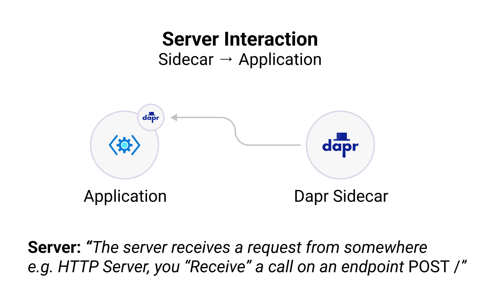
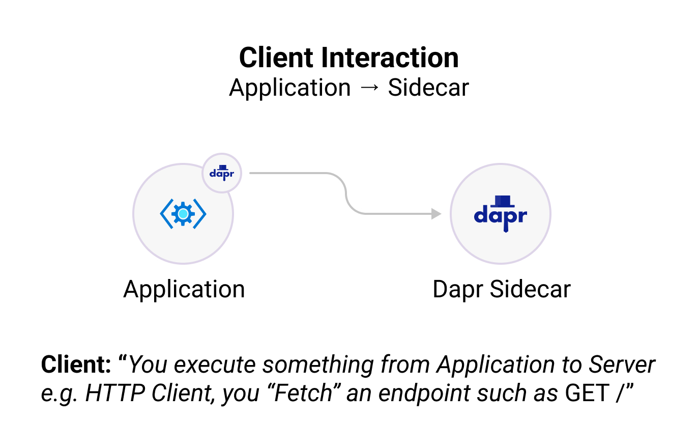

A client library for building Dapr apps in JavaScript and TypeScript. This client abstracts the public Dapr APIs like service to service invocation, state management, pub/sub, secrets, and much more, and provides a simple, intuitive API for building applications.

## Installation

To get started with the JavaScript SDK, install the Dapr JavaScript SDK package from [NPM](https://www.npmjs.com/package/@dapr/dapr):

```bash
npm install --save @dapr/dapr
```

## Configuration

Read application settings and subscribe to changes with `DaprClient.configuration`. The [configuration how-to guide]({}) and [client usage guidance]({}) cover selected or all keys, store-specific metadata, response handling, and subscription cleanup using `@dapr/dapr` 3.19.0 or later. Configuration operations require gRPC in the JavaScript SDK.

## State Management

Save, retrieve, and delete application state with `DaprClient.state`. The SDK supports bulk operations, ETags, consistency options, transactions, TTL metadata, custom serialization, and state queries over HTTP or gRPC.

Follow the [state management how-to guide]({}), read the [client usage guidance]({}) for protocol-specific behavior, or learn how to [query state]({}). These guides target JavaScript SDK 3.19.0 or later.

## Publish and subscribe

Publish single events or batches over HTTP or gRPC, receive programmatic server callbacks, or subscribe through a client-initiated gRPC stream without an application server.

The [publish and subscribe guide]({}) covers JavaScript SDK 3.19.0 or later, including routing, acknowledgements, dead-letter topics, serialization, error handling, and subscription cleanup.

## Service invocation

Call services over HTTP or gRPC and receive invocations through `DaprServer` or an existing HTTP application.

The [service invocation guide]({}) covers JavaScript SDK 3.19.0 or later, including headers, query parameters, callback responses, serialization, error handling, and transport limitations.

## Secrets

Retrieve individual and bulk secrets with `DaprClient.secret`. Follow the [Secrets how-to guide]({}) for setup, or read the [client usage guidance]({}) for metadata, response shapes, and HTTP/gRPC differences. The guides target JavaScript SDK 3.19.0 or later.

## Binary Store

Store, retrieve, stream, and delete binary files with `DaprClient.binaryStore` over HTTP or gRPC. Binary Store requires Dapr runtime 1.19 or later and JavaScript SDK 3.19.0 or later.

Follow the [Binary Store how-to guide]({}) to get started, or read the [client usage guidance]({}) for configuration, streaming, cancellation, and error handling.

## Search

Manage indexes and index, retrieve, delete, and query JSON documents with `DaprClient.search` over HTTP or gRPC. Search requires Dapr runtime 1.19 or later and JavaScript SDK 3.19.0 or later.

Follow the [Search how-to guide]({}) to get started, or read the [client usage guidance]({}) for query options, pagination, write acknowledgements, cancellation, and errors.

## Vector

Store precomputed embeddings and run similarity searches with `DaprClient.vector` over HTTP or gRPC. Vector requires a Vector-capable Dapr runtime from the 1.19 release line or later and JavaScript SDK 3.19.0 or later.

Follow the [Vector how-to guide]({}) to get started, or read the [client usage guidance]({}) for configuration, indexing acknowledgements, cancellation, and error handling.

## Structure

The Dapr JavaScript SDK contains two major components:

- **DaprServer**: to manage all Dapr sidecar to application communication.
- **DaprClient**: to manage all application to Dapr sidecar communication.

The above communication can be configured to use either of the gRPC or HTTP protocols.

<table>
  <tr>
  <td bgcolor="white">  </td>
  <td bgcolor="white">  </td>
  </tr>
</table>

## Getting Started

To help you get started, check out the resources below:

<div class="card-deck">
  <div class="card">
    <div class="card-body">
      <h5 class="card-title"><b>Client</b></h5>
      <p class="card-text">Create a JavaScript client and interact with the Dapr sidecar and other Dapr applications (e.g., publishing events, output binding support, etc.). </p>
      <a href="{}" class="stretched-link"></a>
    </div>
  </div>
  <div class="card">
    <div class="card-body">
      <h5 class="card-title"><b>Server</b></h5>
      <p class="card-text">Create a JavaScript server and let the Dapr sidecar interact with your application (e.g., subscribing to events, input binding support, etc.). </p>
      <a href="{}" class="stretched-link"></a>
    </div>
  </div>
  <div class="card">
    <div class="card-body">
      <h5 class="card-title"><b>Actors</b></h5>
      <p class="card-text">Create virtual actors with state, reminders/timers, and methods.</p>
      <a href="{}" class="stretched-link"></a>
    </div>
  </div>
</div>
<br />
<div class="card-deck">
  <div class="card">
    <div class="card-body">
      <h5 class="card-title"><b>Logging</b></h5>
      <p class="card-text">Configure and customize the SDK logging.</p>
      <a href="{}" class="stretched-link"></a>
    </div>
  </div>
  <div class="card">
    <div class="card-body">
      <h5 class="card-title"><b>Examples</b></h5>
      <p class="card-text">Clone the JavaScript SDK source code and try out some of the examples to get started quickly.</p>
      <a href="{}" class="stretched-link"></a>
    </div>
  </div>
</div>
